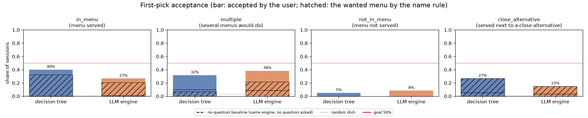
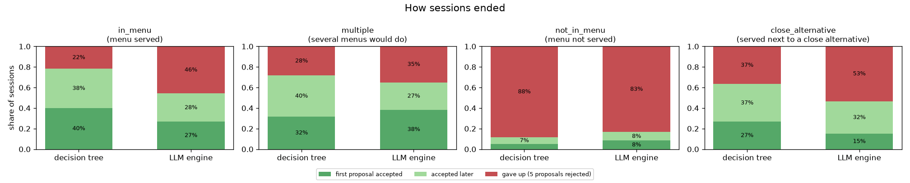
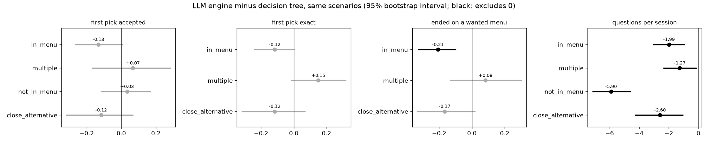
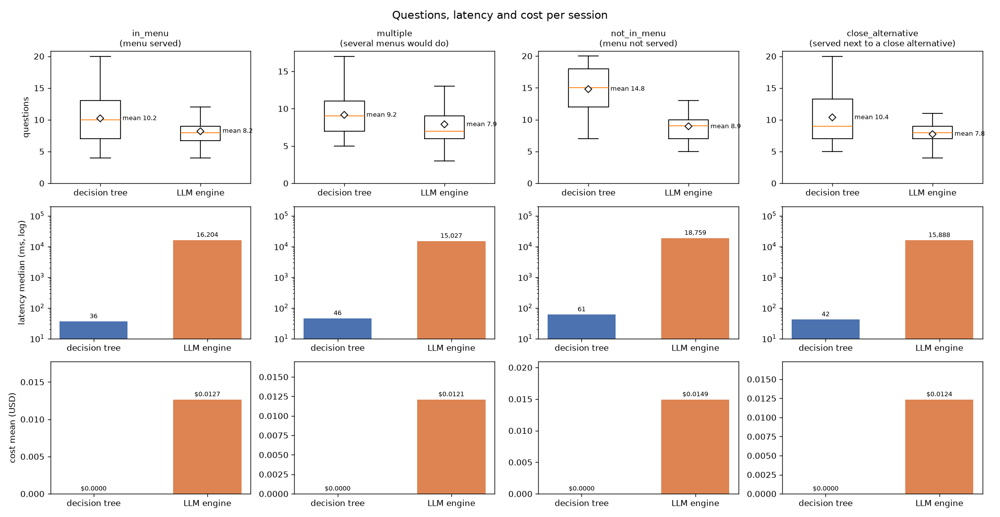
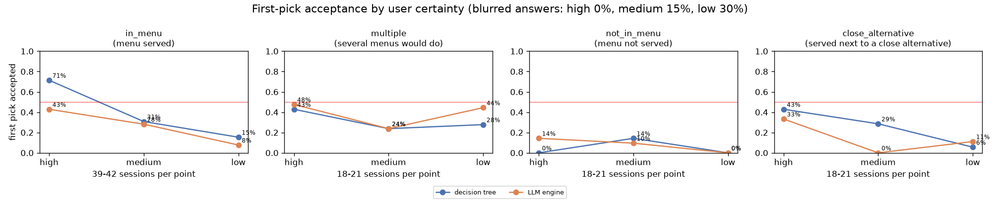

<!-- AI-generated: written with Claude Code (Anthropic) and reviewed by the team. -->
# Question engine benchmark: decision tree vs LLM engine (2026-10-20)

Which engine finds a student's meal faster and more reliably? Sessions played on 2026-10-22 at
commit `e1eeeae` (see the benchmark README on provenance). All numbers are split by situation;
full tables are in [report.md](report.md). Sections 1-3 and the plots are generated by
`benchmark_engines`; section 4 is a manual analysis of the saved sessions.

## 1. Setup

| | |
|---|---|
| Engines | **Decision tree** (MVP1, policy `preference`, v2 features) and **LLM engine** (MVP2, `google/gemini-3.5-flash-lite` on OpenRouter), built as the server builds them |
| Menu | 2026-10-20 lunch (`2026-10-20/LU`), the same candidates for both engines |
| Users | 100 simulated users (scenarios), each played 3 times per engine: **600 sessions** |
| Simulated user | `openai:gpt-6-luna`, a different model from the engine's. It knows only the wanted menu's name, answers one question at a time and decides whether to accept a proposal |
| Limits | at most 20 questions; the user gives up after 5 rejected proposals |

Four situations:

| Situation | Users | The user wants | Example |
|---|---|---|---|
| `in_menu` | 40 | one dish that is served | 돼지김치찌개 |
| `multiple` | 20 | any of 2-3 unrelated served dishes | 칠리마요치킨버거 / 비프버거 / 제육덮밥 |
| `not_in_menu` | 20 | a dish of another day; a close substitute is the best outcome | 생선까스 |
| `close_alternative` | 20 | a served dish with a near-identical neighbour (features within 0.05); the neighbour does not count | 비프해쉬버거 |

Each user also has a **certainty** level: the share of answers that are blurred before the engine
sees them (high 0%, medium 15%, low 30%; half turned into "not sure", half reversed). Both engines
get the same users, menus and blurred answers.

## 2. Evaluation criteria

| Metric | Definition | Goal |
|---|---|---|
| **First-pick acceptance** | the user accepts the engine's first proposal: the wanted dish or a kind of it by name (볶음밥 → 소고기볶음밥), else the simulated user's judgment (strict when served, "would it do instead" when not). `close_alternative` uses the name rule only | ≥ 50%, and 15 points above the baselines |
| First pick (exact) | the name rule alone, no judgment | - |
| Questions | questions per session | fewer is better |
| Latency | engine time per session (user's time excluded) | - |
| Cost | what OpenRouter charged per session | - |

Baselines: **no-question** (the same engine's proposal before any question) and **random dish**.
LLM vs decision tree is tested on the same scenarios: a paired bootstrap 95% interval, with
McNemar for yes/no metrics and Wilcoxon for the others.

## 3. Results

### First-pick acceptance

| Situation | Decision tree | LLM engine |
|---|---|---|
| `in_menu` | **40%** (exact 32%) | 27% (exact 21%) |
| `multiple` | 32% (exact 7%) | **38%** (exact 22%) |
| `not_in_menu` | 5% | 8% |
| `close_alternative` | **27%** | 15% |

- Neither engine reaches 50% in any situation.
- Both beat the baselines (no-question 0-10%, random 1-3%) everywhere except `not_in_menu`.

### How sessions ended

- The decision tree ends on an accepted proposal more often in `in_menu` (78% vs 54%) and `close_alternative` (63% vs 47%).
- In `not_in_menu`, both engines give up in 83-88% of sessions: the simulated user rarely takes a substitute.

### LLM engine minus decision tree

- The LLM engine asks significantly fewer questions in every situation (-1.3 to -5.9), but it
  also proposes more and gives up more often. Questions plus proposals differ significantly
  only in `not_in_menu`.
- Its only significant loss is ending on a wanted dish in `in_menu` (-21 points).
- The first-pick differences are not significant with 20-40 users per situation (`in_menu`:
  interval [-26.7, +0.8] points, McNemar p 0.09).

### Questions, latency, cost

| Situation | Questions (DT / LLM) | Latency median (DT / LLM) | Cost (LLM; DT is free) |
|---|---|---|---|
| `in_menu` | 10.2 / 8.2 | 36 ms / 16.2 s | $0.0127 |
| `multiple` | 9.2 / 7.9 | 46 ms / 15.0 s | $0.0121 |
| `not_in_menu` | 14.8 / 8.9 | 61 ms / 18.8 s | $0.0149 |
| `close_alternative` | 10.4 / 7.8 | 42 ms / 15.9 s | $0.0124 |

## 4. Why first picks fail

A manual analysis of the saved traces (`sessions/sessions.jsonl`, `questions.csv`,
`proposals.csv`); no script in the repo produces these numbers.

1. **Blurred answers.** With clean answers, the decision tree's `in_menu` first pick is 71%; at 30% blur it is 15%. The blur level, more than the engine, sets the result.
2. **The decision tree proposes too early.** It stops once another question is not worth its cost: a median of 7 questions. Its first pick is accepted 25% of the time when its top candidate is below p = 0.3, and 53% when it is at least 0.5.
3. **Set vs single dish.** "Several dishes in one meal?" was answered against the dish's set flag 55 times, and those sessions' first pick is 12%. 36 of the decision tree's 157 wrong first picks were set menus.
4. **Near-duplicate dishes.** 38 of 80 served scenarios have 11 or more dishes within 0.10 feature distance of the wanted one. Synonyms are counted as different dishes (순대야채볶음 / 순대채소볶음).
5. **The LLM engine proposes before narrowing the dish type.** It guesses after about 7 questions, often while the kind of dish (burger, soup, rice bowl) is still open.
6. **`multiple`**: answers are true of at least one wanted dish, so each answer narrows less. This explains the decision tree's 7% exact first pick there.

## 5. Next steps

| Cause | Proposed fix |
|---|---|
| 1 | report by certainty; check whether 30% blur is realistic |
| 2 | a minimum confidence before the decision tree proposes |
| 3 | reword the meal-variety question (bumps `FEATURE_VERSION`) |
| 4 | merge synonyms in the preprocessing catalog (P7); exclude such pairs from `close_alternative` |
| 5 | an LLM prompt hint to settle the dish type before proposing |

The user study (30+ students, section 9 of [report.md](report.md)) will check the simulated user against people.
