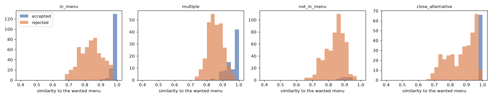

# Question engine benchmark: decision tree (MVP1) vs LLM engine (MVP2)

100 scenarios on 1 menus, 600 sessions (decision_tree 300, llm 300).

## 1. Main metrics

- questions / session: over every session; questions to accept: over accepted sessions.
- first pick: the user accepted the first proposal (a wanted menu or a kind of it, or the simulated user would take it). first pick (exact): the first proposal was a wanted menu or a kind of it by the name rule alone (not defined when the wanted menu is not served). The gap is what the simulated user took in place of the named dish.
- Latency: engine time per session (the user's time is not counted). Cost: what OpenRouter charged the LLM engine per session.
- Goal: first pick >= 50% (and 15% above the baselines, section 2).

**Per situation** (`1_main_metrics/main.csv`)

| situation | engine | sessions | questions / session | questions to accept | first pick | first pick (exact) | latency p50 (ms) | latency p95 (ms) | cost / session | first pick >= 50% |
|---|---|---|---|---|---|---|---|---|---|---|
| in_menu | decision_tree | 120 | 10.2 | 9.074 | 40.0% | 32.5% | 36.1 | 106.6 | $0.00000 | no |
| in_menu | llm | 120 | 8.225 | 7.692 | 26.7% | 20.8% | 16,204.1 | 24,128.3 | $0.01266 | no |
| multiple | decision_tree | 60 | 9.150 | 8.279 | 31.7% | 6.7% | 45.7 | 122.4 | $0.00000 | no |
| multiple | llm | 60 | 7.883 | 7.256 | 38.3% | 21.7% | 15,027.3 | 27,776.5 | $0.01210 | no |
| not_in_menu | decision_tree | 60 | 14.8 | 10.0 | 5.0% | - | 60.6 | 131.0 | $0.00000 | no |
| not_in_menu | llm | 60 | 8.917 | 9.400 | 8.3% | - | 18,759.0 | 28,378.0 | $0.01494 | no |
| close_alternative | decision_tree | 60 | 10.4 | 8.158 | 26.7% | 26.7% | 42.0 | 108.1 | $0.00000 | no |
| close_alternative | llm | 60 | 7.767 | 7.429 | 15.0% | 15.0% | 15,888.4 | 21,678.0 | $0.01235 | no |

**LLM engine sessions with and without a fallback** (`1_main_metrics/main_llm_fallback.csv`)

| situation | LLM sessions | sessions | questions / session | questions to accept | first pick | first pick (exact) | latency p50 (ms) | latency p95 (ms) | cost / session |
|---|---|---|---|---|---|---|---|---|---|
| in_menu | without | 120 | 8.225 | 7.692 | 26.7% | 20.8% | 16,204.1 | 24,128.3 | $0.01266 |
| multiple | without | 59 | 7.780 | 7.256 | 39.0% | 22.0% | 14,996.5 | 25,677.4 | $0.01193 |
| multiple | with a fallback | 1 | 14.0 | - | 0.0% | 0.0% | 27,773.8 | 27,773.8 | $0.02209 |
| not_in_menu | without | 59 | 8.847 | 9.400 | 8.5% | - | 18,590.8 | 27,322.5 | $0.01479 |
| not_in_menu | with a fallback | 1 | 13.0 | - | 0.0% | - | 30,047.4 | 30,047.4 | $0.02344 |
| close_alternative | without | 60 | 7.767 | 7.429 | 15.0% | 15.0% | 15,888.4 | 21,678.0 | $0.01235 |

## 2. Baselines

- First pick (exact) against three baselines in each situation whose wanted menu is served: a baseline is judged by the name rule only, so the engines are too.
- no question: the same engine's "recommend now" before any question; random dish: the chance that a dish picked at random is accepted; and the other engine.
- Each scenario counts once (each engine's repeats averaged). The goal is +15 points or +15% relative; both are shown.

**First pick vs baselines** (`2_baselines/baselines.csv`)

| situation | engine | baseline | scenarios | first pick (exact) | baseline | diff (points) | 95% CI | relative | +15 points | +15% |
|---|---|---|---|---|---|---|---|---|---|---|
| in_menu | decision_tree | no question | 40 | 32.5% | 0.0% | +32.5 | [+20.0, +45.8] | - | yes | no |
| in_menu | decision_tree | random dish | 40 | 32.5% | 1.2% | +31.3 | [+18.8, +44.7] | +2635% | yes | yes |
| in_menu | decision_tree | llm | 40 | 32.5% | 20.8% | +11.7 | [+0.0, +24.2] | +56% | no | yes |
| in_menu | llm | no question | 40 | 20.8% | 0.8% | +20.0 | [+11.7, +29.2] | +2400% | yes | yes |
| in_menu | llm | random dish | 40 | 20.8% | 1.2% | +19.6 | [+11.3, +28.7] | +1653% | yes | yes |
| in_menu | llm | decision_tree | 40 | 20.8% | 32.5% | -11.7 | [-24.2, -0.0] | -36% | no | no |
| multiple | decision_tree | no question | 20 | 6.7% | 10.0% | -3.3 | [-21.7, +11.7] | -33% | no | no |
| multiple | decision_tree | random dish | 20 | 6.7% | 2.7% | +4.0 | [-2.7, +12.6] | +150% | no | yes |
| multiple | decision_tree | llm | 20 | 6.7% | 21.7% | -15.0 | [-31.7, +1.7] | -69% | no | no |
| multiple | llm | no question | 20 | 21.7% | 8.3% | +13.3 | [-3.3, +30.0] | +160% | no | yes |
| multiple | llm | random dish | 20 | 21.7% | 2.7% | +19.0 | [+7.2, +32.5] | +712% | yes | yes |
| multiple | llm | decision_tree | 20 | 21.7% | 6.7% | +15.0 | [-1.7, +31.7] | +225% | no | yes |
| close_alternative | decision_tree | no question | 20 | 26.7% | 5.0% | +21.7 | [+6.7, +38.3] | +433% | yes | yes |
| close_alternative | decision_tree | random dish | 20 | 26.7% | 1.0% | +25.6 | [+9.0, +44.0] | +2518% | yes | yes |
| close_alternative | decision_tree | llm | 20 | 26.7% | 15.0% | +11.7 | [-6.7, +31.7] | +78% | no | yes |
| close_alternative | llm | no question | 20 | 15.0% | 3.3% | +11.7 | [-1.7, +28.3] | +350% | no | yes |
| close_alternative | llm | random dish | 20 | 15.0% | 1.0% | +14.0 | [+2.4, +27.4] | +1373% | no | yes |
| close_alternative | llm | decision_tree | 20 | 15.0% | 26.7% | -11.7 | [-31.7, +6.7] | -44% | no | no |

## 3. Situations

- success: the final menu is a wanted menu or a kind of it (not defined when the wanted menu is not served; see similarity and section 8). close_alternative: only the wanted menu counts, not its close alternative.
- similarity: 1 - mean feature difference to the closest wanted menu; regret: how much closer the best candidate was; rank: share of candidates farther away (1 = closest).
- Certainty blurs 0% (high), 15% (medium) or 30% (low) of the answers, the same way for both engines.

**By situation** (`3_situations/situations.csv`)

| situation | engine | sessions | success | first pick | interactions | gave up | similarity | regret | rank |
|---|---|---|---|---|---|---|---|---|---|
| in_menu | decision_tree | 120 | 64.2% | 40.0% | 12.8 | 21.7% | 0.992 | 0.008 | 0.993 |
| in_menu | llm | 120 | 43.3% | 26.7% | 11.7 | 45.8% | 0.990 | 0.010 | 0.990 |
| multiple | decision_tree | 60 | 30.0% | 31.7% | 12.1 | 28.3% | 0.950 | 0.050 | 0.880 |
| multiple | llm | 60 | 38.3% | 38.3% | 10.8 | 35.0% | 0.978 | 0.022 | 0.950 |
| not_in_menu | decision_tree | 60 | - | 5.0% | 19.5 | 88.3% | 0.926 | 0.015 | 0.993 |
| not_in_menu | llm | 60 | - | 8.3% | 13.5 | 83.3% | 0.888 | 0.053 | 0.894 |
| close_alternative | decision_tree | 60 | 63.3% | 26.7% | 13.6 | 36.7% | 1.000 | 0.000 | 0.998 |
| close_alternative | llm | 60 | 46.7% | 15.0% | 11.5 | 53.3% | 1.000 | 0.000 | 1.000 |

**By situation and user certainty** (`3_situations/situations_by_certainty.csv`)

| situation | certainty | engine | sessions | success | first pick | interactions | gave up | similarity | regret | rank |
|---|---|---|---|---|---|---|---|---|---|---|
| in_menu | high | decision_tree | 42 | 78.6% | 71.4% | 9.429 | 0.0% | 0.995 | 0.005 | 0.994 |
| in_menu | high | llm | 42 | 69.0% | 42.9% | 9.952 | 19.0% | 0.995 | 0.005 | 0.995 |
| in_menu | medium | decision_tree | 39 | 66.7% | 30.8% | 14.6 | 25.6% | 0.991 | 0.009 | 0.993 |
| in_menu | medium | llm | 39 | 41.0% | 28.2% | 11.8 | 48.7% | 0.990 | 0.009 | 0.991 |
| in_menu | low | decision_tree | 39 | 46.2% | 15.4% | 14.7 | 41.0% | 0.987 | 0.013 | 0.989 |
| in_menu | low | llm | 39 | 17.9% | 7.7% | 13.4 | 71.8% | 0.973 | 0.027 | 0.974 |
| multiple | high | decision_tree | 21 | 28.6% | 42.9% | 9.429 | 14.3% | 0.934 | 0.066 | 0.843 |
| multiple | high | llm | 21 | 47.6% | 47.6% | 10.5 | 28.6% | 0.985 | 0.015 | 0.970 |
| multiple | medium | decision_tree | 21 | 38.1% | 23.8% | 13.4 | 38.1% | 0.979 | 0.021 | 0.957 |
| multiple | medium | llm | 21 | 42.9% | 23.8% | 11.8 | 42.9% | 0.989 | 0.011 | 0.974 |
| multiple | low | decision_tree | 18 | 22.2% | 27.8% | 13.5 | 33.3% | 0.943 | 0.057 | 0.852 |
| multiple | low | llm | 18 | 22.2% | 44.4% | 10.2 | 33.3% | 0.959 | 0.041 | 0.900 |
| not_in_menu | high | decision_tree | 21 | - | 0.0% | 21.6 | 100.0% | - | - | - |
| not_in_menu | high | llm | 21 | - | 14.3% | 13.3 | 71.4% | 0.885 | 0.053 | 0.880 |
| not_in_menu | medium | decision_tree | 21 | - | 14.3% | 18.0 | 66.7% | 0.926 | 0.015 | 0.993 |
| not_in_menu | medium | llm | 21 | - | 9.5% | 13.1 | 81.0% | 0.892 | 0.054 | 0.915 |
| not_in_menu | low | decision_tree | 18 | - | 0.0% | 18.7 | 100.0% | - | - | - |
| not_in_menu | low | llm | 18 | - | 0.0% | 14.0 | 100.0% | - | - | - |
| close_alternative | high | decision_tree | 21 | 100.0% | 42.9% | 8.714 | 0.0% | 1.000 | 0.000 | 0.999 |
| close_alternative | high | llm | 21 | 76.2% | 33.3% | 9.905 | 23.8% | 1.000 | 0.000 | 1.000 |
| close_alternative | medium | decision_tree | 21 | 61.9% | 28.6% | 15.3 | 38.1% | 1.000 | 0.000 | 0.998 |
| close_alternative | medium | llm | 21 | 33.3% | 0.0% | 12.4 | 66.7% | 1.000 | 0.000 | 0.999 |
| close_alternative | low | decision_tree | 18 | 22.2% | 5.6% | 17.4 | 77.8% | 1.000 | 0.000 | 1.000 |
| close_alternative | low | llm | 18 | 27.8% | 11.1% | 12.3 | 72.2% | 1.000 | 0.000 | 1.000 |

## 4. Paired tests

- LLM - decision tree per scenario, each engine's mean over its repeats; positive = the LLM engine is higher. 95% bootstrap interval, Wilcoxon signed-rank p, McNemar p for yes/no metrics.

**Paired comparison** (`4_paired_tests/paired.csv`)

| situation | metric | pairs | decision tree | llm | diff | 95% CI | Wilcoxon p | McNemar p |
|---|---|---|---|---|---|---|---|---|
| in_menu | first_guess_accepted | 40 | 0.400 | 0.267 | -0.133 | [-0.267, 0.008] | 0.041 | 0.092 |
| in_menu | first_guess_exact | 40 | 0.325 | 0.208 | -0.117 | [-0.242, -0.000] | 0.051 | 0.109 |
| in_menu | questions | 40 | 10.2 | 8.225 | -1.992 | [-3.025, -0.967] | 0.002 | - |
| in_menu | engine_ms | 40 | 51.4 | 16,061.1 | 16,009.6 | [14,915.5, 17,160.3] | 0.000 | - |
| in_menu | cost_usd | 40 | 0.000 | 0.013 | 0.013 | [0.012, 0.014] | 0.000 | - |
| in_menu | success | 40 | 0.642 | 0.433 | -0.208 | [-0.325, -0.100] | 0.000 | 0.065 |
| in_menu | interactions | 40 | 12.8 | 11.7 | -1.133 | [-2.500, 0.200] | 0.197 | - |
| in_menu | similarity | 31 | 0.987 | 0.988 | 0.001 | [-0.001, 0.004] | 0.249 | - |
| multiple | first_guess_accepted | 20 | 0.317 | 0.383 | 0.067 | [-0.167, 0.283] | 0.954 | 0.727 |
| multiple | first_guess_exact | 20 | 0.067 | 0.217 | 0.150 | [-0.017, 0.317] | 0.104 | 0.625 |
| multiple | questions | 20 | 9.150 | 7.883 | -1.267 | [-2.333, -0.133] | 0.042 | - |
| multiple | engine_ms | 20 | 56.3 | 15,828.0 | 15,771.7 | [13,862.3, 17,831.3] | 0.000 | - |
| multiple | cost_usd | 20 | 0.000 | 0.012 | 0.012 | [0.011, 0.014] | 0.000 | - |
| multiple | success | 20 | 0.300 | 0.383 | 0.083 | [-0.133, 0.300] | 0.431 | 1.000 |
| multiple | interactions | 20 | 12.1 | 10.8 | -1.200 | [-2.750, 0.483] | 0.173 | - |
| multiple | similarity | 15 | 0.946 | 0.978 | 0.032 | [0.012, 0.054] | 0.010 | - |
| not_in_menu | first_guess_accepted | 20 | 0.050 | 0.083 | 0.033 | [-0.117, 0.167] | - | 1.000 |
| not_in_menu | questions | 20 | 14.8 | 8.917 | -5.900 | [-7.133, -4.600] | 0.000 | - |
| not_in_menu | engine_ms | 20 | 71.8 | 18,939.9 | 18,868.2 | [17,773.7, 19,980.9] | 0.000 | - |
| not_in_menu | cost_usd | 20 | 0.000 | 0.015 | 0.015 | [0.014, 0.016] | 0.000 | - |
| not_in_menu | interactions | 20 | 19.5 | 13.5 | -6.000 | [-7.450, -4.383] | 0.000 | - |
| not_in_menu | similarity | 2 | 0.928 | 0.910 | -0.018 | [-0.036, 0.000] | - | - |
| close_alternative | first_guess_accepted | 20 | 0.267 | 0.150 | -0.117 | [-0.317, 0.067] | 0.165 | 0.625 |
| close_alternative | first_guess_exact | 20 | 0.267 | 0.150 | -0.117 | [-0.317, 0.067] | 0.165 | 0.625 |
| close_alternative | questions | 20 | 10.4 | 7.767 | -2.600 | [-4.267, -1.067] | 0.017 | - |
| close_alternative | engine_ms | 20 | 48.4 | 15,650.1 | 15,601.8 | [14,132.6, 17,020.6] | 0.000 | - |
| close_alternative | cost_usd | 20 | 0.000 | 0.012 | 0.012 | [0.011, 0.014] | 0.000 | - |
| close_alternative | success | 20 | 0.633 | 0.467 | -0.167 | [-0.333, 0.017] | 0.057 | 0.125 |
| close_alternative | interactions | 20 | 13.6 | 11.5 | -2.100 | [-4.200, -0.000] | 0.073 | - |
| close_alternative | similarity | 12 | 1.000 | 1.000 | 0.000 | [0.000, 0.000] | - | - |

## 5. Latency and cost

- Engine time only. LLM calls, tokens and cost are the engine's own, as OpenRouter reported them; "recommend now" copies are benchmark overhead and counted apart (totals).

**Per situation** (`5_latency_and_cost/latency_cost.csv`)

| situation | engine | sessions | session ms p50 | p95 | step ms p50 | p95 | LLM calls | input tokens | output tokens | cost / session | cost p95 | sessions with a fallback | errors | recommend-now calls | recommend-now cost |
|---|---|---|---|---|---|---|---|---|---|---|---|---|---|---|---|
| in_menu | decision_tree | 120 | 36.1 | 106.6 | 0.930 | 15.2 | 0.000 | 0 | 0 | $0.00000 | $0.00000 | 0.0% | 0.0% | 0 | $0.00000 |
| in_menu | llm | 120 | 16,204.1 | 24,128.3 | 1,139.0 | 2,501.3 | 12.1 | 30,461 | 1,409 | $0.01266 | $0.01930 | 0.0% | 0.0% | 356 | $0.29886 |
| multiple | decision_tree | 60 | 45.7 | 122.4 | 0.980 | 15.5 | 0.000 | 0 | 0 | $0.00000 | $0.00000 | 0.0% | 0.0% | 0 | $0.00000 |
| multiple | llm | 60 | 15,027.3 | 27,776.5 | 1,146.1 | 2,829.1 | 11.2 | 28,220 | 1,455 | $0.01210 | $0.02067 | 1.7% | 0.0% | 176 | $0.14795 |
| not_in_menu | decision_tree | 60 | 60.6 | 131.0 | 0.850 | 15.7 | 0.000 | 0 | 0 | $0.00000 | $0.00000 | 0.0% | 0.0% | 0 | $0.00000 |
| not_in_menu | llm | 60 | 18,759.0 | 28,378.0 | 1,155.3 | 2,486.6 | 14.3 | 36,220 | 1,629 | $0.01494 | $0.02236 | 1.7% | 0.0% | 180 | $0.15115 |
| close_alternative | decision_tree | 60 | 42.0 | 108.1 | 0.520 | 14.0 | 0.000 | 0 | 0 | $0.00000 | $0.00000 | 0.0% | 0.0% | 0 | $0.00000 |
| close_alternative | llm | 60 | 15,888.4 | 21,678.0 | 1,128.3 | 2,455.1 | 12.1 | 30,068 | 1,333 | $0.01235 | $0.01764 | 0.0% | 0.0% | 179 | $0.15073 |

**Simulated user (benchmark overhead, totals)** (`5_latency_and_cost/simulator_usage.csv`)

| situation | engine | calls | input tokens | output tokens |
|---|---|---|---|---|
| in_menu | decision_tree | 703 | 283,138 | 47,124 |
| in_menu | llm | 1025 | 414,924 | 65,789 |
| multiple | decision_tree | 378 | 160,111 | 34,955 |
| multiple | llm | 493 | 206,818 | 45,883 |
| not_in_menu | decision_tree | 427 | 171,244 | 26,696 |
| not_in_menu | llm | 508 | 203,418 | 30,645 |
| close_alternative | decision_tree | 198 | 77,202 | 13,231 |
| close_alternative | llm | 322 | 125,864 | 24,196 |

## 6. Stability

- The same scenario played several times.

**Over repeats** (`6_stability/stability.csv`)

| situation | engine | scenarios | repeats | same final menu | same outcome | questions SD |
|---|---|---|---|---|---|---|
| in_menu | decision_tree | 40 | 3 | 75.0% | 77.5% | 1.630 |
| in_menu | llm | 40 | 3 | 60.0% | 57.5% | 1.475 |
| multiple | decision_tree | 20 | 3 | 58.3% | 55.0% | 1.214 |
| multiple | llm | 20 | 3 | 45.0% | 45.0% | 1.330 |
| not_in_menu | decision_tree | 20 | 3 | 93.3% | 95.0% | 1.247 |
| not_in_menu | llm | 20 | 3 | 90.0% | 95.0% | 1.774 |
| close_alternative | decision_tree | 20 | 3 | 83.3% | 75.0% | 1.905 |
| close_alternative | llm | 20 | 3 | 66.7% | 50.0% | 1.100 |

## 7. Recommend now

- What the engine would have proposed if the user had stopped answering after k questions.

**After k questions** (`7_recommend_now/recommend_now.csv`)

| situation | engine | k | sessions | success | similarity |
|---|---|---|---|---|---|
| in_menu | decision_tree | 0 | 120 | 0.0% | 0.784 |
| in_menu | decision_tree | 2 | 120 | 11.7% | 0.841 |
| in_menu | decision_tree | 4 | 117 | 15.4% | 0.874 |
| in_menu | llm | 0 | 120 | 0.8% | 0.795 |
| in_menu | llm | 2 | 120 | 0.0% | 0.814 |
| in_menu | llm | 4 | 116 | 7.8% | 0.841 |
| multiple | decision_tree | 0 | 60 | 10.0% | 0.836 |
| multiple | decision_tree | 2 | 60 | 6.7% | 0.850 |
| multiple | decision_tree | 4 | 60 | 5.0% | 0.863 |
| multiple | llm | 0 | 60 | 8.3% | 0.840 |
| multiple | llm | 2 | 60 | 3.3% | 0.859 |
| multiple | llm | 4 | 56 | 5.4% | 0.865 |
| not_in_menu | decision_tree | 0 | 60 | - | 0.807 |
| not_in_menu | decision_tree | 2 | 60 | - | 0.828 |
| not_in_menu | decision_tree | 4 | 60 | - | 0.841 |
| not_in_menu | llm | 0 | 60 | - | 0.806 |
| not_in_menu | llm | 2 | 60 | - | 0.822 |
| not_in_menu | llm | 4 | 60 | - | 0.833 |
| close_alternative | decision_tree | 0 | 60 | 5.0% | 0.779 |
| close_alternative | decision_tree | 2 | 60 | 0.0% | 0.810 |
| close_alternative | decision_tree | 4 | 60 | 10.0% | 0.862 |
| close_alternative | llm | 0 | 60 | 3.3% | 0.789 |
| close_alternative | llm | 2 | 60 | 8.3% | 0.824 |
| close_alternative | llm | 4 | 59 | 8.5% | 0.872 |

## 8. Similarity

- For choosing the similarity that counts as a success when the wanted menu is not served.

**Similarity of proposals to the wanted menu, by verdict (percentiles)** (`8_similarity/similarity.csv`)

| situation | verdict | proposals | p10 | p25 | p50 | p75 | p90 |
|---|---|---|---|---|---|---|---|
| in_menu | rejected | 566 | 0.749 | 0.785 | 0.840 | 0.882 | 0.931 |
| in_menu | accepted | 159 | 0.960 | 1.000 | 1.000 | 1.000 | 1.000 |
| multiple | rejected | 270 | 0.797 | 0.822 | 0.851 | 0.884 | 0.909 |
| multiple | accepted | 82 | 0.900 | 0.930 | 0.989 | 1.000 | 1.000 |
| not_in_menu | rejected | 535 | 0.749 | 0.798 | 0.851 | 0.889 | 0.910 |
| not_in_menu | accepted | 17 | 0.866 | 0.876 | 0.905 | 0.926 | 0.947 |
| close_alternative | rejected | 354 | 0.740 | 0.797 | 0.889 | 0.941 | 0.964 |
| close_alternative | accepted | 66 | 1.000 | 1.000 | 1.000 | 1.000 | 1.000 |

**Share of not-served sessions whose final menu reaches each threshold** (`8_similarity/thresholds.csv`)

| engine | sessions | >= 0.70 | >= 0.75 | >= 0.80 | >= 0.85 | >= 0.90 | >= 0.95 |
|---|---|---|---|---|---|---|---|
| decision_tree | 60 | 11.7% | 11.7% | 11.7% | 11.7% | 11.7% | 0.0% |
| llm | 60 | 16.7% | 16.7% | 16.7% | 16.7% | 5.0% | 0.0% |

## 9. User study

Skipped: No sessions played by people (play_engine_session).
