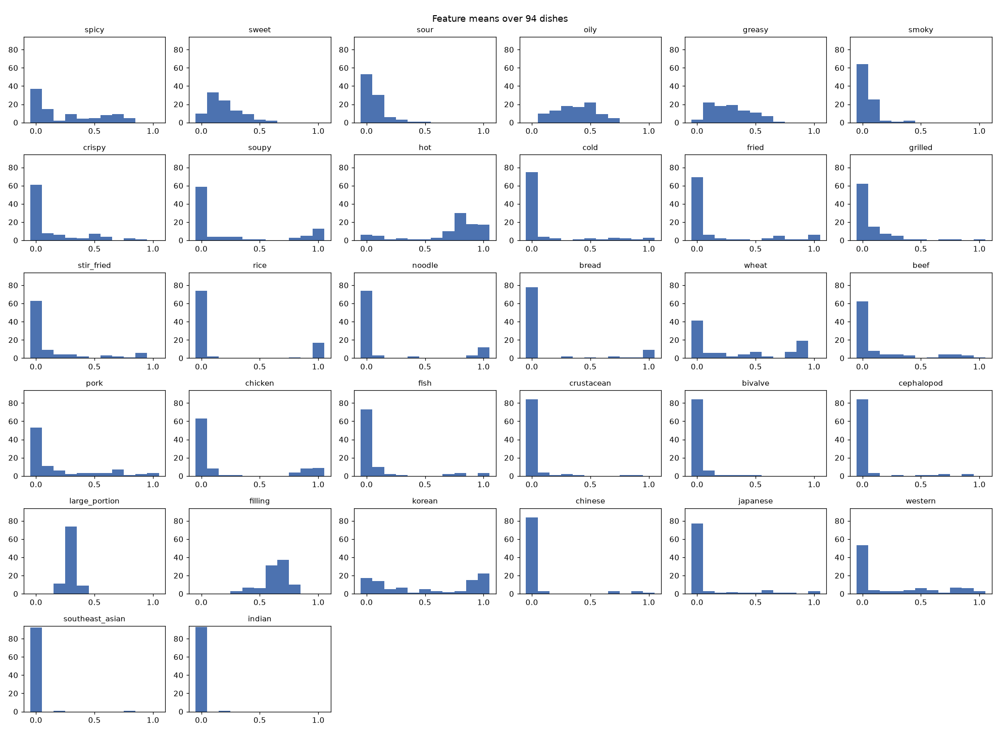
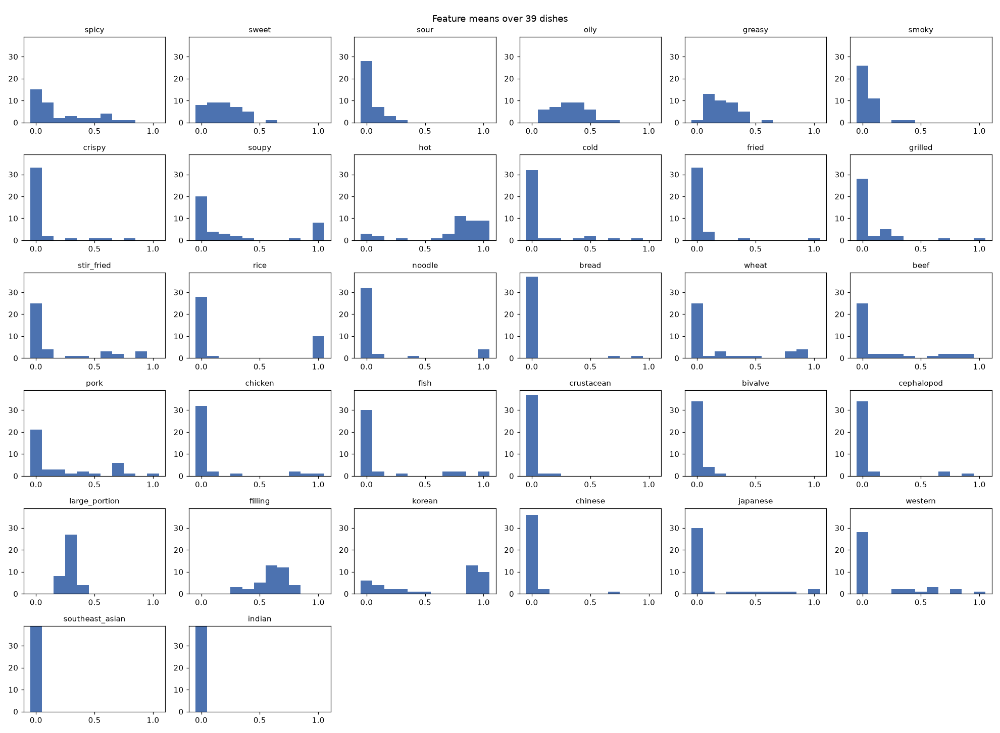
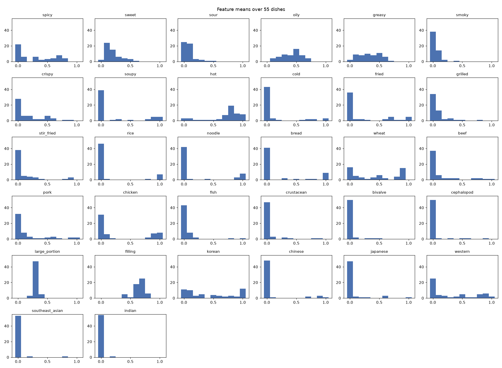

# Feature extraction benchmark

966 records in 7 runs: repeat-0, repeat-1, repeat-2, shuffle_features-0, shuffle_features-1, shuffle_foods-0, shuffle_foods-1. model: openai:gpt-6-luna. prompt_hash: 48c43e2ebbb3, 8c30306f9f80, bb3c9cc99a35. condition: repeat, shuffle_features, shuffle_foods.

Only integrity passes or fails. The other sections are measurements to read; see menus/features/benchmark/ for what each one means.

## Summary

| section | result |
|---|---|
| 1. Integrity | pass |
| 2. Distribution | reported |
| 2. Distribution (variant) | reported |
| 2. Distribution (invariant) | reported |
| 3. Stability | reported |
| 3. Stability (variant) | reported |
| 3. Stability (invariant) | reported |
| 4. Human reference | skipped |
| 4. Human reference (variant) | skipped |
| 4. Human reference (invariant) | skipped |
| 5. Triplets | reported |
| 6. Downstream impact | skipped |

## 1. Integrity

- 966 records, 0 with problems; those are left out of the other sections.
- records with 33/32 keys and bounded two-decimal values: 966/966 (expected all) pass

**Problems**: 0 rows in `1_integrity/integrity_problems.csv`

## 2. Distribution

- 94 dishes, 32 features.
- Collisions (mean gap <= 0.05): 41 pairs.

**Per feature (histogram: dishes at 0.0, 0.1, ... 1.0)** (`2_distribution/distribution.csv`)

| feature | mean | low | mid | high | mean std | histogram |
|---|---|---|---|---|---|---|
| spicy | 0.26 | 0.63 | 0.26 | 0.12 | 0.093 | 37 15 2 8 5 5 9 8 5 0 0 |
| sweet | 0.2 | 0.78 | 0.22 | 0.0 | 0.1 | 10 33 24 11 11 3 2 0 0 0 0 |
| sour | 0.06 | 0.97 | 0.03 | 0.0 | 0.051 | 53 30 6 3 1 1 0 0 0 0 0 |
| oily | 0.38 | 0.35 | 0.64 | 0.01 | 0.128 | 0 10 13 18 18 21 9 5 0 0 0 |
| greasy | 0.29 | 0.54 | 0.45 | 0.01 | 0.117 | 3 21 20 18 13 11 7 1 0 0 0 |
| smoky | 0.05 | 0.98 | 0.02 | 0.0 | 0.047 | 64 25 2 1 2 0 0 0 0 0 0 |
| crispy | 0.13 | 0.82 | 0.15 | 0.03 | 0.055 | 61 8 6 3 2 7 4 0 2 1 0 |
| soupy | 0.24 | 0.73 | 0.04 | 0.22 | 0.036 | 60 3 4 4 1 1 0 0 3 5 13 |
| hot | 0.73 | 0.13 | 0.09 | 0.79 | 0.09 | 6 5 1 2 1 1 3 10 30 18 17 |
| cold | 0.11 | 0.86 | 0.05 | 0.09 | 0.026 | 75 4 2 0 1 2 1 3 2 1 3 |
| fried | 0.15 | 0.82 | 0.06 | 0.12 | 0.033 | 69 6 2 1 1 0 3 4 1 1 6 |
| grilled | 0.08 | 0.91 | 0.05 | 0.03 | 0.047 | 62 15 7 5 1 1 0 1 1 0 1 |
| stir_fried | 0.14 | 0.83 | 0.09 | 0.09 | 0.043 | 63 9 4 4 2 0 3 2 1 6 0 |
| rice | 0.19 | 0.81 | 0.0 | 0.19 | 0.01 | 74 2 0 0 0 0 0 0 1 0 17 |
| noodle | 0.17 | 0.82 | 0.02 | 0.16 | 0.013 | 74 3 0 0 2 0 0 0 0 3 12 |
| bread | 0.14 | 0.83 | 0.04 | 0.13 | 0.014 | 78 0 0 2 0 1 0 2 1 1 9 |
| wheat | 0.34 | 0.57 | 0.15 | 0.28 | 0.074 | 41 5 7 2 4 7 2 0 7 19 0 |
| beef | 0.15 | 0.82 | 0.09 | 0.1 | 0.055 | 62 8 4 3 4 0 1 4 4 3 1 |
| pork | 0.19 | 0.74 | 0.15 | 0.11 | 0.067 | 53 11 6 2 3 3 4 6 1 2 3 |
| chicken | 0.22 | 0.77 | 0.01 | 0.22 | 0.032 | 63 8 1 1 0 0 0 0 4 8 9 |
| fish | 0.09 | 0.91 | 0.0 | 0.09 | 0.027 | 73 9 3 1 0 0 0 2 3 0 3 |
| crustacean | 0.04 | 0.96 | 0.02 | 0.02 | 0.017 | 84 4 1 2 1 0 0 0 1 1 0 |
| bivalve | 0.02 | 0.98 | 0.02 | 0.0 | 0.016 | 84 6 1 1 1 1 0 0 0 0 0 |
| cephalopod | 0.05 | 0.93 | 0.04 | 0.03 | 0.015 | 84 3 0 1 0 1 1 2 0 2 0 |
| large_portion | 0.3 | 0.63 | 0.37 | 0.0 | 0.135 | 0 0 14 70 10 0 0 0 0 0 0 |
| filling | 0.63 | 0.01 | 0.71 | 0.28 | 0.119 | 0 0 0 3 7 6 31 37 10 0 0 |
| korean | 0.51 | 0.45 | 0.12 | 0.44 | 0.077 | 17 14 7 5 1 5 3 2 3 15 22 |
| chinese | 0.07 | 0.93 | 0.01 | 0.06 | 0.011 | 84 3 0 0 0 0 0 3 0 3 1 |
| japanese | 0.1 | 0.87 | 0.07 | 0.05 | 0.025 | 77 3 1 2 1 1 4 1 1 0 3 |
| western | 0.25 | 0.66 | 0.17 | 0.17 | 0.057 | 53 3 4 3 4 6 4 1 7 6 3 |
| southeast_asian | 0.01 | 0.99 | -0.0 | 0.01 | 0.004 | 92 0 1 0 0 0 0 0 1 0 0 |
| indian | 0.0 | 1.0 | 0.0 | 0.0 | 0.002 | 93 0 1 0 0 0 0 0 0 0 0 |

**Collisions** (`2_distribution/distribution_collisions.csv`, first 10 of 41)

| dish_a | dish_b | mean_gap |
|---|---|---|
| 순대야채볶음 | 순대채소볶음 | 0.012 |
| 북어국 | 황태해장국 | 0.016 |
| 치킨버거 | 화이트어니언치킨버거 | 0.016 |
| 비빔냉면 | 비빔막국수 | 0.018 |
| 돈까스 | 치즈돈까스 | 0.019 |
| 매운양념치킨 | 양념치킨 | 0.026 |
| 데리마요치킨버거 | 화이트어니언치킨버거 | 0.027 |
| 눈꽃치즈떡볶이 | 떡볶이 | 0.028 |
| 소이마요치킨 | 핫소마요치킨 | 0.029 |
| 핫치킨버거 | 화이트어니언치킨버거 | 0.03 |

## 2. Distribution (variant)

- 39 dishes, 32 features.
- Collisions (mean gap <= 0.05): 4 pairs.

**Per feature (histogram: dishes at 0.0, 0.1, ... 1.0)** (`2_distribution/distribution_variant.csv`)

| feature | mean | low | mid | high | mean std | histogram |
|---|---|---|---|---|---|---|
| spicy | 0.2 | 0.72 | 0.23 | 0.05 | 0.085 | 15 9 2 3 2 2 4 1 1 0 0 |
| sweet | 0.19 | 0.77 | 0.23 | 0.0 | 0.098 | 8 9 9 6 6 0 1 0 0 0 0 |
| sour | 0.05 | 1.0 | 0.0 | 0.0 | 0.037 | 28 7 3 1 0 0 0 0 0 0 0 |
| oily | 0.32 | 0.46 | 0.51 | 0.03 | 0.124 | 0 6 7 9 9 6 1 1 0 0 0 |
| greasy | 0.22 | 0.69 | 0.31 | 0.0 | 0.109 | 1 12 11 9 5 0 1 0 0 0 0 |
| smoky | 0.04 | 0.97 | 0.03 | 0.0 | 0.041 | 26 11 0 1 1 0 0 0 0 0 0 |
| crispy | 0.06 | 0.9 | 0.08 | 0.03 | 0.025 | 33 2 0 1 0 1 1 0 1 0 0 |
| soupy | 0.27 | 0.74 | 0.03 | 0.23 | 0.045 | 21 3 3 2 1 0 0 0 1 0 8 |
| hot | 0.74 | 0.13 | 0.08 | 0.79 | 0.082 | 3 2 0 1 0 0 1 3 11 9 9 |
| cold | 0.09 | 0.87 | 0.08 | 0.05 | 0.026 | 32 1 1 0 1 2 0 1 0 1 0 |
| fried | 0.05 | 0.95 | 0.03 | 0.03 | 0.012 | 33 4 0 0 1 0 0 0 0 0 1 |
| grilled | 0.09 | 0.92 | 0.03 | 0.05 | 0.04 | 28 2 5 2 0 0 0 1 0 0 1 |
| stir_fried | 0.18 | 0.77 | 0.13 | 0.1 | 0.049 | 25 4 0 1 1 0 3 2 0 3 0 |
| rice | 0.25 | 0.74 | 0.0 | 0.26 | 0.012 | 28 1 0 0 0 0 0 0 0 0 10 |
| noodle | 0.11 | 0.87 | 0.03 | 0.1 | 0.013 | 32 2 0 0 1 0 0 0 0 0 4 |
| bread | 0.04 | 0.95 | 0.0 | 0.05 | 0.006 | 37 0 0 0 0 0 0 1 0 1 0 |
| wheat | 0.21 | 0.77 | 0.05 | 0.18 | 0.053 | 25 1 3 1 1 1 0 0 3 4 0 |
| beef | 0.18 | 0.77 | 0.13 | 0.1 | 0.061 | 25 2 2 1 2 0 1 2 2 2 0 |
| pork | 0.22 | 0.69 | 0.18 | 0.13 | 0.074 | 21 3 3 1 2 1 1 5 1 0 1 |
| chicken | 0.1 | 0.87 | 0.03 | 0.1 | 0.023 | 32 2 0 1 0 0 0 0 2 1 1 |
| fish | 0.14 | 0.85 | 0.0 | 0.15 | 0.029 | 30 2 0 1 0 0 0 2 2 0 2 |
| crustacean | 0.01 | 1.0 | 0.0 | 0.0 | 0.008 | 37 1 1 0 0 0 0 0 0 0 0 |
| bivalve | 0.01 | 1.0 | 0.0 | 0.0 | 0.015 | 34 4 1 0 0 0 0 0 0 0 0 |
| cephalopod | 0.06 | 0.92 | 0.03 | 0.05 | 0.015 | 34 2 0 0 0 0 0 2 0 1 0 |
| large_portion | 0.29 | 0.69 | 0.31 | 0.0 | 0.132 | 0 0 9 26 4 0 0 0 0 0 0 |
| filling | 0.6 | 0.03 | 0.77 | 0.21 | 0.12 | 0 0 0 3 2 5 13 12 4 0 0 |
| korean | 0.61 | 0.36 | 0.05 | 0.59 | 0.071 | 6 4 3 1 1 1 0 0 0 13 10 |
| chinese | 0.02 | 0.97 | 0.0 | 0.03 | 0.009 | 36 2 0 0 0 0 0 1 0 0 0 |
| japanese | 0.14 | 0.82 | 0.08 | 0.1 | 0.029 | 30 1 0 1 1 1 1 1 1 0 2 |
| western | 0.16 | 0.74 | 0.18 | 0.08 | 0.042 | 28 0 0 2 2 1 3 0 2 0 1 |
| southeast_asian | 0.0 | 1.0 | 0.0 | 0.0 | 0.0 | 39 0 0 0 0 0 0 0 0 0 0 |
| indian | 0.0 | 1.0 | 0.0 | 0.0 | 0.0 | 39 0 0 0 0 0 0 0 0 0 0 |

**Collisions** (`2_distribution/distribution_collisions_variant.csv`)

| dish_a | dish_b | mean_gap |
|---|---|---|
| 순대야채볶음 | 순대채소볶음 | 0.012 |
| 북어국 | 황태해장국 | 0.016 |
| 미역국 | 북어국 | 0.049 |
| 고추장불고기 | 오돈불고기 | 0.05 |

## 2. Distribution (invariant)

- 55 dishes, 32 features.
- Collisions (mean gap <= 0.05): 29 pairs.

**Per feature (histogram: dishes at 0.0, 0.1, ... 1.0)** (`2_distribution/distribution_invariant.csv`)

| feature | mean | low | mid | high | mean std | histogram |
|---|---|---|---|---|---|---|
| spicy | 0.3 | 0.56 | 0.27 | 0.16 | 0.099 | 22 6 0 5 3 3 5 7 4 0 0 |
| sweet | 0.2 | 0.78 | 0.22 | 0.0 | 0.102 | 2 24 15 5 5 3 1 0 0 0 0 |
| sour | 0.08 | 0.95 | 0.05 | 0.0 | 0.06 | 25 23 3 2 1 1 0 0 0 0 0 |
| oily | 0.42 | 0.27 | 0.73 | 0.0 | 0.13 | 0 4 6 9 9 15 8 4 0 0 0 |
| greasy | 0.34 | 0.44 | 0.55 | 0.02 | 0.123 | 2 9 9 9 8 11 6 1 0 0 0 |
| smoky | 0.05 | 0.98 | 0.02 | 0.0 | 0.052 | 38 14 2 0 1 0 0 0 0 0 0 |
| crispy | 0.17 | 0.76 | 0.2 | 0.04 | 0.076 | 28 6 6 2 2 6 3 0 1 1 0 |
| soupy | 0.23 | 0.73 | 0.05 | 0.22 | 0.029 | 39 0 1 2 0 1 0 0 2 5 5 |
| hot | 0.72 | 0.13 | 0.09 | 0.78 | 0.095 | 3 3 1 1 1 1 2 7 19 9 8 |
| cold | 0.13 | 0.85 | 0.04 | 0.11 | 0.026 | 43 3 1 0 0 0 1 2 2 0 3 |
| fried | 0.23 | 0.73 | 0.09 | 0.18 | 0.048 | 36 2 2 1 0 0 3 4 1 1 5 |
| grilled | 0.08 | 0.91 | 0.07 | 0.02 | 0.052 | 34 13 2 3 1 1 0 0 1 0 0 |
| stir_fried | 0.11 | 0.87 | 0.05 | 0.07 | 0.038 | 38 5 4 3 1 0 0 0 1 3 0 |
| rice | 0.14 | 0.85 | 0.0 | 0.15 | 0.008 | 46 1 0 0 0 0 0 0 1 0 7 |
| noodle | 0.2 | 0.78 | 0.02 | 0.2 | 0.014 | 42 1 0 0 1 0 0 0 0 3 8 |
| bread | 0.21 | 0.75 | 0.07 | 0.18 | 0.02 | 41 0 0 2 0 1 0 1 1 0 9 |
| wheat | 0.43 | 0.44 | 0.22 | 0.35 | 0.088 | 16 4 4 1 3 6 2 0 4 15 0 |
| beef | 0.13 | 0.85 | 0.05 | 0.09 | 0.05 | 37 6 2 2 2 0 0 2 2 1 1 |
| pork | 0.17 | 0.78 | 0.13 | 0.09 | 0.062 | 32 8 3 1 1 2 3 1 0 2 2 |
| chicken | 0.3 | 0.69 | 0.0 | 0.31 | 0.038 | 31 6 1 0 0 0 0 0 2 7 8 |
| fish | 0.05 | 0.96 | 0.0 | 0.04 | 0.026 | 43 7 3 0 0 0 0 0 1 0 1 |
| crustacean | 0.05 | 0.93 | 0.04 | 0.04 | 0.023 | 47 3 0 2 1 0 0 0 1 1 0 |
| bivalve | 0.03 | 0.96 | 0.04 | 0.0 | 0.017 | 50 2 0 1 1 1 0 0 0 0 0 |
| cephalopod | 0.05 | 0.93 | 0.05 | 0.02 | 0.015 | 50 1 0 1 0 1 1 0 0 1 0 |
| large_portion | 0.3 | 0.58 | 0.42 | 0.0 | 0.137 | 0 0 5 44 6 0 0 0 0 0 0 |
| filling | 0.65 | 0.0 | 0.67 | 0.33 | 0.118 | 0 0 0 0 5 1 18 25 6 0 0 |
| korean | 0.44 | 0.51 | 0.16 | 0.33 | 0.082 | 11 10 4 4 0 4 3 2 3 2 12 |
| chinese | 0.1 | 0.89 | 0.02 | 0.09 | 0.013 | 48 1 0 0 0 0 0 2 0 3 1 |
| japanese | 0.06 | 0.91 | 0.07 | 0.02 | 0.022 | 47 2 1 1 0 0 3 0 0 0 1 |
| western | 0.32 | 0.6 | 0.16 | 0.24 | 0.068 | 25 3 4 1 2 5 1 1 5 6 2 |
| southeast_asian | 0.02 | 0.98 | 0.0 | 0.02 | 0.006 | 53 0 1 0 0 0 0 0 1 0 0 |
| indian | 0.0 | 1.0 | 0.0 | 0.0 | 0.003 | 54 0 1 0 0 0 0 0 0 0 0 |

**Collisions** (`2_distribution/distribution_collisions_invariant.csv`, first 10 of 29)

| dish_a | dish_b | mean_gap |
|---|---|---|
| 치킨버거 | 화이트어니언치킨버거 | 0.016 |
| 돈까스 | 치즈돈까스 | 0.019 |
| 매운양념치킨 | 양념치킨 | 0.026 |
| 데리마요치킨버거 | 화이트어니언치킨버거 | 0.027 |
| 눈꽃치즈떡볶이 | 떡볶이 | 0.028 |
| 소이마요치킨 | 핫소마요치킨 | 0.029 |
| 핫치킨버거 | 화이트어니언치킨버거 | 0.03 |
| 닭가슴살샐러드 | 치킨샐러드 | 0.032 |
| 데리마요치킨버거 | 치킨버거 | 0.032 |
| 치킨버거 | 핫치킨버거 | 0.032 |

## 3. Stability

- `repeat`: 138 dishes x 3 runs; mean SD of means 0.018 (largest 0.40), of stds 0.010; flips 0.14%
- `shuffle_features`: 138 dishes x 2 runs; mean SD of means 0.015 (largest 0.49), of stds 0.008; flips 0.02%
- `shuffle_foods`: 138 dishes x 2 runs; mean SD of means 0.020 (largest 0.60), of stds 0.011; flips 0.11%
- The conditions have different run counts (repeat 3, shuffle_features 2, shuffle_foods 2). An SD from two runs is noisy, so small differences between conditions are not meaningful.
- `repeat` vs `shuffle_features`: averaged means of 138 shared dishes differ by 0.017 per feature
- `repeat` vs `shuffle_foods`: averaged means of 138 shared dishes differ by 0.020 per feature
- `shuffle_features` vs `shuffle_foods`: averaged means of 138 shared dishes differ by 0.021 per feature

**Per feature**: 96 rows in `3_stability/stability_by_feature.csv`

**Least stable (dish, feature) cells** (`3_stability/stability_unstable_cells.csv`, first 15 of 255)

| condition | dish | feature | lowest mean | highest mean | flip |
|---|---|---|---|---|---|
| shuffle_foods | 케이크 | bread | 0.0 | 0.85 | flip |
| repeat | 닭죽 | soupy | 0.0 | 0.75 | flip |
| shuffle_foods | 콘치즈베이크 | bread | 0.0 | 0.75 | flip |
| shuffle_foods | 콘치즈베이크 | wheat | 0.05 | 0.8 | flip |
| repeat | 케이크 | bread | 0.0 | 0.7 | flip |
| shuffle_features | 핫도그 | fried | 0.2 | 0.9 | flip |
| repeat | 떡볶이 | stir_fried | 0.1 | 0.75 | flip |
| repeat | 라볶이 | stir_fried | 0.1 | 0.7 | flip |
| shuffle_features | 케이크 | bread | 0.05 | 0.65 |  |
| shuffle_features | 핫도그 | bread | 0.35 | 0.95 |  |
| repeat | 유부초밥 | fried | 0.08 | 0.65 |  |
| repeat | 콘치즈베이크 | bread | 0.1 | 0.65 |  |
| shuffle_foods | 닭곰탕 | rice | 0.1 | 0.65 |  |
| shuffle_foods | 마라쌀국수 | soupy | 0.35 | 0.9 |  |
| repeat | 치킨카레 | rice | 0.0 | 0.5 |  |

## 3. Stability (variant)

- `repeat`: 39 dishes x 3 runs; mean SD of means 0.017 (largest 0.39), of stds 0.009; flips 0.16%
- `shuffle_features`: 39 dishes x 2 runs; mean SD of means 0.016 (largest 0.49), of stds 0.008; flips 0.08%
- `shuffle_foods`: 39 dishes x 2 runs; mean SD of means 0.020 (largest 0.32), of stds 0.010; flips 0.08%
- The conditions have different run counts (repeat 3, shuffle_features 2, shuffle_foods 2). An SD from two runs is noisy, so small differences between conditions are not meaningful.
- `repeat` vs `shuffle_features`: averaged means of 39 shared dishes differ by 0.016 per feature
- `repeat` vs `shuffle_foods`: averaged means of 39 shared dishes differ by 0.019 per feature
- `shuffle_features` vs `shuffle_foods`: averaged means of 39 shared dishes differ by 0.020 per feature

**Per feature**: 96 rows in `3_stability/stability_by_feature_variant.csv`

**Least stable (dish, feature) cells** (`3_stability/stability_unstable_cells_variant.csv`, first 15 of 88)

| condition | dish | feature | lowest mean | highest mean | flip |
|---|---|---|---|---|---|
| repeat | 닭죽 | soupy | 0.0 | 0.75 | flip |
| shuffle_features | 핫도그 | fried | 0.2 | 0.9 | flip |
| shuffle_features | 핫도그 | bread | 0.35 | 0.95 |  |
| repeat | 유부초밥 | fried | 0.08 | 0.65 |  |
| shuffle_features | 씨리얼 | cold | 0.1 | 0.55 |  |
| shuffle_features | 핫도그 | western | 0.35 | 0.8 |  |
| shuffle_features | 핫도그 | crispy | 0.2 | 0.65 |  |
| shuffle_foods | 하이라이스 | japanese | 0.25 | 0.7 | flip |
| shuffle_features | 보쌈 | hot | 0.25 | 0.65 |  |
| shuffle_foods | 비빔막국수 | wheat | 0.25 | 0.65 |  |
| shuffle_foods | 알리오올리오 | stir_fried | 0.15 | 0.55 |  |
| shuffle_foods | 오므라이스 | fried | 0.0 | 0.4 |  |
| shuffle_foods | 카프레제샐러드 | cold | 0.25 | 0.65 |  |
| repeat | 씨리얼 | crispy | 0.3 | 0.7 | flip |
| shuffle_foods | 핫도그 | western | 0.45 | 0.85 |  |

## 3. Stability (invariant)

- `repeat`: 55 dishes x 3 runs; mean SD of means 0.020 (largest 0.38), of stds 0.011; flips 0.11%
- `shuffle_features`: 55 dishes x 2 runs; mean SD of means 0.017 (largest 0.32), of stds 0.009; flips 0.00%
- `shuffle_foods`: 55 dishes x 2 runs; mean SD of means 0.022 (largest 0.53), of stds 0.012; flips 0.11%
- The conditions have different run counts (repeat 3, shuffle_features 2, shuffle_foods 2). An SD from two runs is noisy, so small differences between conditions are not meaningful.
- `repeat` vs `shuffle_features`: averaged means of 55 shared dishes differ by 0.020 per feature
- `repeat` vs `shuffle_foods`: averaged means of 55 shared dishes differ by 0.023 per feature
- `shuffle_features` vs `shuffle_foods`: averaged means of 55 shared dishes differ by 0.024 per feature

**Per feature**: 96 rows in `3_stability/stability_by_feature_invariant.csv`

**Least stable (dish, feature) cells** (`3_stability/stability_unstable_cells_invariant.csv`, first 15 of 118)

| condition | dish | feature | lowest mean | highest mean | flip |
|---|---|---|---|---|---|
| shuffle_foods | 콘치즈베이크 | bread | 0.0 | 0.75 | flip |
| shuffle_foods | 콘치즈베이크 | wheat | 0.05 | 0.8 | flip |
| repeat | 떡볶이 | stir_fried | 0.1 | 0.75 | flip |
| repeat | 콘치즈베이크 | bread | 0.1 | 0.65 |  |
| shuffle_foods | 마라쌀국수 | soupy | 0.35 | 0.9 |  |
| repeat | 콘치즈베이크 | wheat | 0.15 | 0.65 |  |
| shuffle_foods | 치즈돈까스 | korean | 0.15 | 0.65 |  |
| shuffle_foods | 콘치즈베이크 | korean | 0.15 | 0.65 |  |
| repeat | 불닭모짜렐라치즈버거 | fried | 0.1 | 0.55 |  |
| repeat | 쉬림프치즈베이크 | grilled | 0.1 | 0.55 |  |
| repeat | 쉬림프치즈베이크 | rice | 0.0 | 0.45 |  |
| shuffle_features | 짜장면 | korean | 0.2 | 0.65 |  |
| shuffle_foods | 물냉면 | wheat | 0.2 | 0.65 |  |
| repeat | 불닭모짜렐라치즈버거 | grilled | 0.15 | 0.55 |  |
| shuffle_features | 짜장면 | stir_fried | 0.25 | 0.65 |  |

## 4. Human reference

Skipped: No rating file. Make the form with export_feature_rating_form and pass the filled copies with --ratings.

## 4. Human reference (variant)

Skipped: No rating file. Make the form with export_feature_rating_form and pass the filled copies with --ratings.

## 4. Human reference (invariant)

Skipped: No rating file. Make the form with export_feature_rating_form and pass the filled copies with --ratings.

## 5. Triplets

- 51 of 51 triplets evaluated: 100.0% pass (a random vector passes 50%); with cosine distance 100.0%.
- By kind and source: close 100% (24), distinct 100% (27), ai 100% (51)

**All triplets**: 51 rows in `5_triplets/triplets.csv`

**Failed (worst first)**: 0 rows in `5_triplets/triplets_failed.csv`

## 6. Downstream impact

Skipped: Needs at least two dishes with both a complete human reference (--ratings) and extracted features.
